# System architecture

The system separates offline corpus construction, request-time research, and administrator-only evaluation. The source corpus and indexes are read during research; query handling and evaluation do not rebuild or resize them.

## Offline indexing

PubMed source records are normalized and deduplicated into the active 29,994-record corpus. Indexing creates MedCPT dense embeddings, a BM25 sparse index, a MeSH dictionary and graph, and dense/sparse Qdrant vectors. The index manifest binds the point count and artifacts to the corpus checksums.

## Query and research workflow

Query understanding produces a structured plan and applies guarded route selection. The bounded research planner represents work as a dependency-checked research-plan DAG with subquestions and coverage states. Retrieval can use four comparable paths: dense-only (`dense_only`), hybrid dense/BM25/MeSH, reranked (the `reranked` variant sends the hybrid pool through a cross-encoder), and agentic (the `agentic` workflow combines planning, evidence coverage, and bounded correction).

Evidence sufficiency checks can trigger corrective retrieval within the configured loop budget. Evidence rows retain source PMIDs, exact abstract spans, and retrieval-channel provenance. Claim repair removes or rewrites unsupported claims and can abstain when a claim cannot be tied to evidence. Citation validation checks source identity and span membership before a response is returned.

## Public and administrator projections

Ordinary-user responses contain the research interpretation, qualitative evidence coverage, exact supporting spans, and source metadata. Their projection excludes numeric retrieval scores, internal traces, and evaluation metrics. Administrators can inspect the bounded audit trace. Evaluation bundles are read-only and available only through the administrator evaluation API and dashboard; ordinary-user research views do not expose report values or evaluation metrics.

The diagram source is [architecture.mmd](architecture.mmd), rendered to [architecture.svg](architecture.svg).
